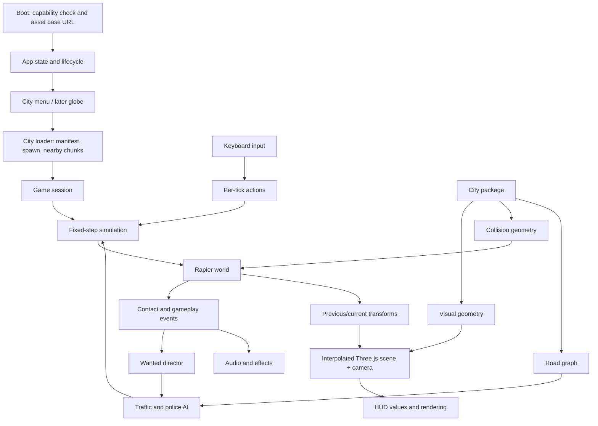

# Roadster Flight — version-one architecture

Planning baseline: October 16, 2026. Reviewed starter commit: `8a06122`.
Status: target architecture. Foundation and part of milestone one are now implemented;
see [current build status](BUILD_STATUS.md). Future systems below remain planned.

## 1. Product target

Make a free desktop browser driving game with a recognisable next-generation
Roadster, real street layouts, convincing materials, and playful thruster physics.
Keep the name **Roadster Flight**. The distinguishing experience is driving through
a real district, hopping over traffic, rolling in the air, landing, and escaping a
police chase.

Treat “looks like the real one” as two concrete requirements:

- The hero car follows the October 15, 2026 reveal: silhouette, proportions,
  glazing, lights, wheels, rear treatment, and visible thruster locations. An old
  2017 concept model is only a temporary substitute, labelled in the asset ledger.
- Cities retain actual street topology, block shapes, building footprints, and
  selected recognisable landmarks. Use realistic daylight and materials. OSM
  footprints alone cannot provide street-level photographic fidelity; that needs
  additional building/landmark assets and texture work.

The Roadster reveal is the inspiration. The reported 2028 production date is a
target, not an established delivery date. Flight duration, force, pressure refill,
and adhesive driving in this game are tunable arcade rules, not validated vehicle
engineering. Official reference: [Tesla Roadster](https://www.tesla.com/roadster).
Contemporary reveal reference:
[MotorTrend first look](https://www.motortrend.com/news/first-look-2028-tesla-roadster-performance-thrust-rocket).

### Scope boundaries

| First playable milestone | Complete version one | Later possibilities |
| --- | --- | --- |
| One bounded New York district; drive, brake, boost, hop, land, reset; chase camera | Flight assistance, F barrel roll, selected inverted stunt surfaces, traffic, wanted system, police cars, helicopter, globe, four bounded city districts, sound and settings | Whole-city coverage, multiplayer, mobile, gamepad, cockpit, pedestrians, missions, detailed damage, day/night weather |

Version one is a single-player free-roam game. All other cars have ordinary road
physics. No login, paid city access, backend simulation, or live map query is needed
to play. “New York” means a named playable district, not all five boroughs. Globe
selection loads another district; continuous flight between cities is outside v1.

## 2. Original starter baseline

| File | Current behaviour | Planned treatment |
| --- | --- | --- |
| `index.html` | Fullscreen HUD and four city buttons | Keep the fullscreen entry and city IDs; replace inline presentation with a small UI layer |
| `src/main.js` | CDN Three.js 0.170.0, flat ground, rotating box, fixed camera | Replace incrementally with an application lifecycle and a physics-owned car |
| `README.md` | Concept and draft stack | Keep as the project entry point and link these implementation documents |

At the reviewed starter commit there was no input controller, map loading, Rapier, car model, traffic, police,
build tooling, tests, dependency lockfile, or Pages workflow. Every city button
started the same placeholder. Avoid presenting those original buttons as evidence
that four cities are implemented.

## 3. Stack decisions

| Concern | Decision | Reason |
| --- | --- | --- |
| Rendering | Three.js, one WebGL2 renderer | Fits starter; car, city, effects, globe share familiar tooling |
| Language/build | TypeScript + Vite + npm lockfile | Explicit data contracts, bundled imports, reproducible static builds |
| Physics | `@dimforge/rapier3d-compat`, single-threaded WASM initially | Rigid bodies, ray queries, contacts, vehicle controller; static-host compatible path |
| Vehicle | Rapier raycast vehicle controller + separate thrust/attitude systems | Reuse suspension/tyre mechanics; keep flight on the same chassis body |
| Default city | Build-time OSM extract → static district package | Real geography, predictable download size, no runtime API quota |
| Optional 3D tiles | `3d-tiles-renderer` adapter inside Three.js | Avoid running a second CesiumJS renderer beside the game |
| UI | HTML/CSS overlays and small TS controllers | Simple keyboard-friendly menus; no UI framework needed yet |
| AI routing | Imported directed road graph + A* + steering | Street-aware traffic and pursuit without a navigation service |
| Sound | Three.js/Web Audio after Start interaction | Positional sirens and controlled mixing |
| Persistence | Versioned localStorage settings | Keep volume, graphics, selected city; no server |
| Verification | Vitest for simulation/data rules; Playwright browser smoke checks | Verify meaningful failure cases and static deployment |
| Deployment | Vite `dist/` through GitHub Actions to GitHub Pages | Free static runtime within service limits |

Resolve and lock compatible package versions during foundation work. Do not
blindly upgrade Three.js while porting the starter. Bundle runtime dependencies,
WASM, decoders, and assets instead of depending on mutable third-party CDN URLs.
Start from the official libraries and examples; reuse third-party driving code
only after checking its licence, maintenance, and integration cost.

### Why not CesiumJS plus Three.js plus MapLibre?

These are rendering tools, not interchangeable map subscriptions. Running all of
them creates camera, coordinate, depth, picking, GPU, and lifecycle problems.
Three.js owns the game. OSM supplies data; it does not require MapLibre. The globe
is a lightweight Three.js menu, not a reason to adopt a second world engine.

If tiles become useful, evaluate the existing
[3D Tiles renderer and provider examples](https://github.com/NASA-AMMOS/3DTilesRendererJS)
inside the same renderer. Build only the bundled provider for the first milestone;
keep the provider boundary small rather than implementing two city stacks now.

## 4. World data decision and fidelity

| Path | Visual potential | Driving/collision work | Hosting/cost fit | v1 decision |
| --- | --- | --- | --- | --- |
| Bundled OSM district | Authentic layout; basic extrusions need materials and landmark detail | Generate clean roads, simplified buildings, and graph from the same data | Keyless, finite package, static hosting | Default |
| Open municipal 3D data | Better roof/building geometry; texture availability varies | Convert, simplify, register to road data | Source-specific redistribution and size checks | Evaluate for selected landmarks/district upgrades |
| Cesium ion / Google photorealistic tiles | Strong aerial realism; close roads may contain baked cars and uneven surfaces | Independent gameplay roads/colliders still required | Keys, quotas, attribution, provider conditions | Optional later experiment |

This choice preserves the free first release. It does not promise a photographically
exact city. If street-level photorealism becomes a hard requirement, explicitly
revisit asset effort and provider budget before expanding the map.

Google tiles are not a source for extracted road meshes, collision databases, or
offline city packs. Its policies restrict non-visualisation extraction and storage.
Keep any optional gameplay data independently sourced; provider suitability for
this game must be checked before enabling it. See
[Map Tiles API policies](https://developers.google.com/maps/documentation/tile/policies).
Cesium-hosted data is also subject to plan and content conditions; free hosting of
the app does not remove those limits. See
[Cesium pricing](https://cesium.com/platform/cesium-ion/pricing/) and
[content attribution guidance](https://cesium.com/learn/ion/content-usage-and-attribution-guide/).

## 5. Runtime architecture



Use a small collection of explicit systems and entity IDs. A general-purpose ECS,
multiplayer architecture, or engine abstraction is unnecessary for this scope.
`App` owns the single renderer/canvas for its lifetime. Each session owns its
scene, physics world and acquired assets; switching cities disposes session
resources while retaining the renderer. Shared assets need explicit reference
ownership so session cleanup cannot dispose an asset still in use.

### Ownership and module contracts

| Module | Owns | Must not own |
| --- | --- | --- |
| `App` | Boot, menu/loading/playing/paused/error states; session switching | Vehicle forces or provider credentials |
| `GameSession` | One city, one Rapier world, entities, system disposal | Global listeners that survive disposal |
| `InputManager` | Held keys, press/release edges, action snapshots | Render-frame-dependent force changes |
| `PhysicsWorld` | Bodies, colliders, stepping, queries, contact queue | Visual meshes |
| `VehicleController` | Ground drive, brake, steering, suspension | UI and city downloads |
| `ThrusterController` | Pressure, impulses, lift, roll target, landing assist | Teleporting or directly rotating the mesh |
| `WorldStreamer` | Chunk readiness, neighbouring requests, physics/render lifetimes | Wanted or AI decisions |
| `TrafficSystem` | Lane followers, stop/yield logic, traffic spawn budget | Whole-world rigid-body simulation |
| `WantedSystem` | Incident rules, heat, last-seen state, escalation events | Reading every render object each frame |
| `PursuitDirector` | Police budgets, intercept goals, helicopter state | Undocumented knowledge of the player behind walls |
| `CameraRig` | Follow smoothing, obstruction avoidance, camera presets | Altering physics orientation |
| `Effects/Audio` | Pooled particles, impact sounds, sirens, visual lamps | Gameplay damage or authoritative heat |
| `HUD` | Speed, pressure, wanted state, control hints, errors | Simulation state mutation outside actions |

Suggested event payloads include `CollisionIncident(tick, pairId, severity,
position, playerResponsible)`, `WantedChanged(level)`, `PlayerSpotted(position,
source)`, `ChunkReady(id)`, and `SessionEnded(reason)`. Queue events during the tick
and deliver them after physics; never remove physics objects from inside a contact
callback. Avoid per-frame allocation of event objects where profiling shows cost.

### Frame loop

Use metres, kilograms, seconds, Y-up, gravity `(0, -9.81, 0)`. The car uses local
+Z forward and +Y up; rotate imported models once to match. Explicitly configure
the vehicle controller axes and test steering/braking signs.

1. Read keyboard events into an input buffer.
2. Clamp wall-clock delta to 100 ms; add to an accumulator.
3. For each 1/60 s step, up to five steps per frame:
   - Consume edge actions once; sample held actions.
   - Update low-frequency AI when due, then steering and vehicle forces.
   - Update suspension/tyres, thrust, attitude control and adhesion.
   - Step Rapier; drain contacts; update heat, pressure and timers.
   - Store previous/current physics transforms.
4. If overloaded, drop excess accumulated time and record it in diagnostics.
5. Interpolate visual transforms using the remaining fraction. Update camera,
   effect placement, HUD and renderer.

Forces are evaluated each tick; impulses are applied once per activation. Follow
Rapier's force-reset semantics so continuous inputs do not accidentally accumulate
forces. Configure suspension on a tuning course before city integration.

On blur or visibility loss, clear held keys and pause. On resume, reset accumulator
and timestamp. Menus capture navigation keys; the game prevents Space/arrow page
scroll only while focused. Ignore key repeat for flip, hop, reset, camera, pause,
and city navigation. A complete key press/release between two ticks must still
produce one action.

Start single-threaded. Pages does not offer general custom response-header
configuration for a threaded WASM deployment, so shared-memory physics must not be
a v1 prerequisite. Offline preprocessing handles expensive map conversion.

## 6. Vehicle and flight design

### Ground driving

Use one dynamic chassis with a small compound of boxes/convex hulls and four
suspension rays. The detailed GLB is visual only. Start with stable arcade grip,
speed-dependent steering, braking before reverse, limited lateral slip, and a
low centre of mass. Wheels spin and steer from controller state. Derive HUD speed
from world velocity and convert m/s to km/h.

Enable appropriate fast-body collision protection on the player and test against
walls and moving cars. CCD helps but does not replace thick road surfaces, sensible
speed caps, and stress tests. Library references:
[vehicle controller](https://rapier.rs/javascript3d/classes/DynamicRayCastVehicleController.html),
[continuous collision detection](https://rapier.rs/docs/user_guides/javascript/rigid_body_ccd/).

| Input | Grounded | Airborne |
| --- | --- | --- |
| W / Up | Accelerate; brake out of reverse | Assisted pitch forward |
| S / Down | Brake, then reverse near rest | Assisted pitch back |
| A/D or Left/Right | Steer, reducing angle at speed | Assisted yaw |
| Space held | Forward boost using pressure | Forward thrust using pressure |
| Shift press / hold | One hop impulse on press | In flight milestone, held input supplies limited lift |
| F press | No roll; HUD hint if needed | Start one assisted barrel roll if clearance/pressure allow |
| R press | Reset to safe road pose | Same, with brief reset cooldown |
| C press | Cycle chase/close chase | Same; camera remains horizon stable |
| Escape | Pause/menu | Pause/menu |

These are keyboard-only defaults. Camera and reset must also be usable from the
pause menu. Support either Shift key. Surface adhesion is automatic on designated
stunt surfaces so the initial control set stays small.

### Thrust and pressure

- Central `VehicleTuning` stores mass, acceleration, speed cap, tyre/suspension
  parameters, hop target, thrust, angular limits, pressure capacity/cost/refill,
  and assists. Label these as game values.
- Apply boost in chassis-forward direction. For v1 assistance, apply lift toward
  world-up so the keyboard flight model stays manageable while rolling. Document
  that this is an assist rather than a nozzle-level simulation.
- A hop starts with a mass-scaled impulse derived from a target height:
  `deltaV = sqrt(2 * |gravity| * hopHeight)`, adjusted for existing upward velocity.
  Tune an initial 2–3 m hop with a capped launch impulse and a cooldown. Landing
  requires several valid contact ticks before another grounded hop.
- Use one pressure pool for boost/lift/roll, with per-second costs for held actions
  and one-time costs for hop/flip. Refill only after a grounded idle delay. Show
  remaining pressure and insufficient-pressure feedback.
- Regular flight is a limited assisted hop/glide. Pressure depletion removes
  powered lift; gravity and ordinary collisions continue. Do not promise
  unlimited hovering or silently teleport the car to ground.

### Modes and flips

`GROUNDED`, `AIRBORNE`, `ADHERED`, and `RESETTING` describe contact/control modes.
Boost and flip are action states layered on top, not replacements for the body.
Use contact hysteresis to avoid rapid grounded/airborne flicker.

An F press captures a roll axis and target of one complete turn relative to the
starting pose. Drive bounded angular velocity/torque with a damped attitude
controller; do not tween Euler angles or mesh rotation. Suspend automatic upright
assistance during the intentional roll. Reject repeat F actions until completion
or cancellation. A collision, imminent landing, or expired roll timeout cancels
the manoeuvre safely. Mid-flight clearance checks use independent game colliders
and remain conservative; failure still resolves through normal physics.

Landing assistance damps excess angular motion and aligns toward a detected valid
surface near touchdown, within strict force/torque caps. It cannot erase a major
collision. A failed landing may leave the car stuck; R always recovers it.

### Upside-down driving

Ship one short, clearly marked inverted ramp/loop as a separate stunt overlay in
the real district. OSM does not supply driveable ceilings. Keep its invented
geometry distinct from imported geography.

Tag eligible colliders `adhesionEligible`. Probe from the wheel side, find a
consistent surface normal, apply a capped force into the surface and align the
chassis toward wheel contact. Standard suspension may not behave adequately
inverted: validate the stock controller early and add an explicit surface-drive
assist for this mode if needed. Support tangent-direction grip and drive, not just
an upside-down visual pose.

Adhesion requires close valid wheel-side contact and normal consistency. Cap force,
speed and duration; disengage on distance, edge discontinuity, or hop input. Initial
v1 adhesion has its own duration/assist budget rather than pretending suction uses
the gas pressure tank. Do not let the vehicle attach to every building wall.

## 7. City package and import pipeline

### First district

Start with approximately 1 km × 1 km around a Midtown Manhattan street grid.
Candidate anchor: latitude 40.7549, longitude -73.9840. Confirm exact bounds and
spawn after inspecting source data; these are planning coordinates. Seek a
connected driving loop, a long boost straight, a recognisable skyline view, and
space for a labelled stunt pad. Avoid making tunnels, complex highway stacks, or
bridges mandatory for the first playable route.

### Offline pipeline

```text
Pinned regional OSM extract / small development query
  -> crop selected district plus boundary buffer
  -> normalise tags, units, multipolygon relations and stable IDs
  -> project coordinates into local metres
  -> create roads / intersections / sidewalks / building footprints
  -> derive directed graph and lane guide paths
  -> simplify independent gameplay collision geometry
  -> split into spatial chunks and generate visual LODs
  -> validate connectivity, seams, spawn and byte budgets
  -> emit manifest + static assets + source/attribution records
```

Use existing OSM parsers, polygon triangulation and mesh optimisation tools; write
the glue and game-specific conversion. Public Overpass can help acquire a small
development sample under its instance policy; gameplay must never depend on it.
Prefer a pinned regional extract for reproducible builds. Record input URL, extract
date, checksum, tool version and conversion settings. Store large raw inputs
outside the shipped site; preserve an obtainable source/derived-data release.

Handle `oneway`, roundabouts, access, bridges, tunnels, `layer`, road class,
building height/levels, holes and multipolygons. Preserve vertical separation:
geometric crossings at different levels must not become graph intersections.
OSM often lacks exact width, elevation, lane routing and facade appearance. Mark
estimated widths/heights in metadata, use deterministic defaults, and manually
QA the playable route. Road joins must be continuous, not overlapping ribbons
with gaps, sharp height steps, or cop cars cutting across buildings.

Author explicit junction connectors/stop lines where lane detail is missing.
For the initial mostly flat route, use a consistent ground plane and exclude
unresolved elevated/tunnel roads. Later terrain uses licensed elevation data and
graded road surfaces. Do not invent a bridge's height from its `layer` tag alone.

### Coordinates

Persist source locations as WGS84 longitude/latitude. Convert to an east/north/up
local tangent frame around the district origin, then map to Three.js
`x = east, y = up, z = -north`. Store spawn position and heading in that same
documented frame. The car's local +Z forward is independent of geographic north.
Test a known 100 m distance and heading before importing a full district.

Each city starts a new local world. Never pass Earth-scale ECEF coordinates into
Rapier or combine degrees with metre geometry. A floating origin can wait until
the bounded district demonstrably needs it. Optional tiles must be transformed
into this exact frame as part of their provider adapter.

### Planned files and contracts

```text
public/cities/new-york-midtown/
  manifest.json
  road-graph.json
  chunks/000-000.visual.glb
  chunks/000-000.collision.json
  ...
  attribution.json
  source.json
```

```ts
// Design sketch; field constraints become versioned schemas in milestone 1.
type Vec3 = [number, number, number];
type CityManifest = {
  schemaVersion: 1;
  id: string;
  name: string;
  drivingSide: 'left' | 'right';
  origin: { latitude: number; longitude: number; altitudeMeters: number };
  bounds: { min: Vec3; max: Vec3 };
  spawns: { id: string; position: Vec3; headingRadians: number }[];
  roadGraphUrl: string;
  chunks: {
    id: string;
    bounds: { min: Vec3; max: Vec3 };
    visualUrl: string;
    collisionUrl: string;
    estimatedBytes: number;
    contentHash: string;
  }[];
  attributionUrl: string;
  sourceUrl: string;
};
```

Road graph nodes carry position and level; directed edges carry source way ID,
polyline, length, speed, direction, lanes, permitted turns and intersection IDs.
Keep physics collision IDs mapped to semantic object IDs for incidents. Fail on
schema mismatch, invalid indices, NaNs or missing required collision assets.

Paths in manifests resolve relative to the manifest URL. App paths resolve through
Vite's base URL so `/roadster-flight/` deployment works. Avoid root-absolute
`/cities/...` paths.

### Collision and streaming

Render geometry and collision geometry are separate outputs of the same source
pipeline. Use fixed triangle meshes for clean road slabs/stunt surfaces, simple
extruded footprint hulls or compounds for buildings, and box/hull colliders for
dynamic cars and breakable props. Never use the hero car's detailed mesh as a
dynamic triangle-mesh collider.

Initial chunk size: 200–250 m. Keep collision chunks near the player and predicted
landing area; render farther skyline chunks at lower detail. Keep owned bodies
for nearby traffic/police only. Chunk states are `UNREQUESTED -> LOADING -> READY
-> ACTIVE -> EVICTING`, plus retryable `FAILED`. Activate physics at a tick boundary
before allowing the car into that region. Do not unload collision geometry under
a live body, police route, or landing prediction. Deduplicate objects spanning
chunk edges with stable source IDs and ownership rules.

Load spawn and neighbouring colliders before enabling controls. A bounded queue
prioritises the direction of travel and landing corridor. Look-ahead distance must
cover measured load latency plus braking distance, not just a fixed chunk count.
If readiness falls behind, show a loading boundary and stop/fade-reset before the
missing area. Never let the car drive into a world without collision.

Fence the district with an intentional playable-boundary treatment and safe reset.
After a completed city change, dispose the old session's renderer-owned resources,
physics world, audio sources, events and async requests. A request generation ID
or abort signal prevents a late response from entering the next city.

## 8. Traffic, incidents and police

### Traffic

Start with 8–12 simple vehicles following directed lane paths. Use desired-speed
control, steering look-ahead, braking distance, lead-vehicle checks and basic
intersection stop/yield rules. Implement a short obstacle look-ahead for the player
and stalled vehicles. Use predictable round-robin turns at unsignalled test
junctions before implementing more complex signals.

Near vehicles use dynamic bodies and the same ground-control primitives. Distant
traffic may be path-only visuals; promote/demote outside the player's immediate
interaction area with clearance checks, velocity continuity and hysteresis. Do not
convert a colliding vehicle to kinematic and push the player through a wall.
Spawn on valid free road segments outside the camera, never in the player or on
closed lanes. Despawn outside interaction range; recycle stuck cars discreetly.

### Incident rules

Capture contact-force/impact information, relative closing speed, participants and
player responsibility. Sustained resting forces are not new crashes. Deduplicate
by pair, impact start and cooldown. Ignore road/tyre/curb support contacts and
minor taps. Suggested initial tiers are minor property hit, major car/prop crash,
and police collision; calibrate thresholds against actual test impacts.

Breakable furniture can switch from fixed to a small debris pool once per incident.
Cosmetic damage is sufficient for v1; buildings do not crumble. Persist incidents
only during the session. Thrust, speed or flight alone does not add heat in v1;
crashes are the user's requested trigger.

### Wanted state

Use five displayed levels with configurable heat thresholds. Proposed dispatch:

| Level | Behaviour |
| --- | --- |
| 0 | No active pursuit |
| 1 | One patrol follows last known road position |
| 2 | Two police cars coordinate pursuit |
| 3 | Up to three cars; predictive road interception |
| 4 | Up to four cars plus one helicopter |
| 5 | Same bounded entity count, stronger coordination and longer search |

These are design defaults, not a promise of realistic policing. Severe fresh
incidents raise heat immediately; existing contacts cannot raise it every tick.
After the last confirmed sighting, show a search state. Begin heat decay after a
configurable unseen delay, e.g. 12 s, and step down over time. Fresh contact or an
incident restarts the timer. Pause freezes timers; reset does not erase wanted
state or let repeated R presses evade pursuit.

### Pursuit AI

Police states: `SPAWN -> INTERCEPT -> PURSUE -> SEARCH -> DISENGAGE`, with a stuck
recovery branch. Use A* over the directed road graph to reach a predicted road
position ahead of the player, then steering along the lane path. Replan around
2 Hz and on route invalidation; steering updates at the fixed tick. Different cars
choose pursuit/intercept roles rather than stacking at one target.

Perception uses distance, facing, and line-of-sight rays against game colliders at
a bounded rate. Track the latest *observed* position and velocity. When a player
flies, ground cops pursue a reachable likely landing road, not a straight line up
a building. On lost sight they search near the last known road position and then
disengage. Stuck timers reroute or recycle offscreen; no visible teleportation.

One high-heat helicopter uses a simple guided flight controller, altitude and
obstacle checks, capped speed, a spotlight, and its own line of sight. It can
maintain sightings but cannot see through buildings or guarantee capture. No
weapons are needed. “Busted” requires a police car nearby and the player almost
stationary for a short visible countdown; being airborne alone is not capture.

## 9. Presentation and globe

Use realistic paint, glass, tyres and asphalt; one daylight environment, restrained
contrast, grounded scale, and contact shadows. Prioritise the car and the road
immediately around it. Avoid substituting a neon wireframe city or random towers
for the requested real-world setting. Standard PBR materials, an environment map,
one shadowed sun and tone mapping are sufficient initially. Cold-gas thrusters use
short pale vapour jets and sound; avoid presenting them as persistent rocket fire.

Use a horizon-stable spring chase camera with obstruction sphere casts and smoothed
distance/FOV changes. Keep horizon stable during barrel rolls to preserve control
readability. Add a closer external view with C; cockpit and mouse orbit can wait.

HUD: km/h, pressure, wanted/search state, brief controls, reset hint, and permanent
map attribution. Minimal loading/menu UI must explain district coverage. A reduced
motion setting suppresses strong camera shake and exaggerated FOV effects.

For the globe milestone, draw a textured sphere with four geographic markers and
city names. WASD/arrows navigate markers, Enter confirms, Escape returns. Mouse
selection can be additive, but every action works by keyboard. Show package status
(`available`, `loading`, `unavailable`); an unavailable city cannot silently start a
New York copy. Animate the selection, fade, load the new district, and spawn there.
Dispose or suspend globe GPU work during play.

City configuration is data-driven: New York and Dubai use right-side traffic;
Tokyo and London use left-side traffic. Each has its own graph, spawn, ground
elevation, visual package, attribution, and landmarks. The same controller/AI
operates all four without city-name conditionals in simulation code.

## 10. Performance and reliability budgets

These are initial engineering targets to measure, not current benchmark results.
Choose and record exact reference hardware during foundation work: one integrated
GPU laptop and one ordinary desktop, each with browser/OS versions.

| Metric | Initial target / action |
| --- | --- |
| Reference desktop | 60 FPS at 1080p medium; p95 frame time under 20 ms on the recorded route |
| Integrated laptop | Playable 30 FPS at 720p low; p95 frame time under 40 ms |
| Fixed simulation | 60 Hz; aim for p95 physics + gameplay below 4 ms on desktop |
| Spawn payload | At most 25 MB transferred for app, physics, car and playable spawn |
| One district | Aim for at most 80 MB shipped assets; load by chunk |
| Loading | Aim for under 15 s to drive with cold cache at 25 Mbps |
| Scene complexity | Initially <=250 visible draw calls and <=1M visible triangles on medium |
| Physics | Initially <=32 nearby dynamic vehicle/prop bodies plus pooled debris |
| Memory | Aim for <=512 MB estimated working set and <=256 MB texture allocations; measure supported counters |
| Repeated city changes | Return near baseline resource counts; no sustained growth over ten switches |

Use instancing for repeated props/traffic variants, shared material atlases, mesh
LODs, limited shadow distance, capped device pixel ratio, compressed textures, and
bounded particle/debris pools. Run AI perception/routing below rendering frequency.
Profile before adding workers or another rendering engine. Test worst-case flight
over dense roofs and a level-five chase, not only an empty street.

Failure handling: explicit unsupported-WebGL screen; retry for city fetch errors;
recoverable asset fallback for optional sounds/props; a required-car or required-
collision failure keeps the session in loading/error state. Handle WebGL context
loss with a clear recovery/reload path. Save settings defensively if localStorage
is unavailable. Do not require all browsers to support the same memory API.

## 11. Planned repository layout

```text
index.html
package.json / package-lock.json / tsconfig.json / vite.config.ts
src/
  main.ts
  app/{App,GameSession}.ts
  core/{Clock,InputManager,Events,Settings}.ts
  rendering/{Renderer,CameraRig,Lighting,Effects}.ts
  physics/{PhysicsWorld,CollisionGroups}.ts
  vehicle/{Vehicle,VehicleController,ThrusterController,AdhesionController,VehicleTuning}.ts
  world/{CityProvider,BundledCityProvider,CityManifest,WorldStreamer,GeoFrame}.ts
  traffic/{RoadGraph,Router,LaneFollower,TrafficSystem}.ts
  police/{WantedSystem,PursuitDirector,PoliceCar,Helicopter,Perception}.ts
  audio/AudioSystem.ts
  ui/{HUD,Menu,GlobeMenu,styles.css}
public/
  assets/{vehicles,textures,audio,environment}/
  cities/{new-york-midtown,tokyo,london,dubai}/
tools/city/{import,normalise,roads,buildings,graph,collisions,pack,validate}/
data/sources/                 # small metadata; large raw extracts stay outside Git
tests/{simulation,data,browser}/
docs/{ARCHITECTURE,ROADMAP,ASSETS}.md
.github/workflows/{ci,pages}.yml
THIRD_PARTY_NOTICES.md
```

Only create modules as their milestone needs them. `OptionalTilesProvider` is a
future extension, not an empty framework to implement up front.

## 12. Deployment, source records and verification

GitHub Pages serves the built site, not raw TypeScript or a simulation server.
Set Vite `base` to `/roadster-flight/` for the project site. Use `npm ci`, typecheck,
focused tests, production build, and the Pages upload/deploy actions. Grant CI only
the Pages permissions needed and serialise deployments. Deploy the agreed main
branch; do not publish planning-branch previews without a deliberate workflow.
See [Vite deployment guidance](https://vite.dev/guide/static-deploy.html#github-pages).

Lazy-load cities and verify assets/WASM/decoder fetches from the real nested Pages
URL. Do not rely on Git LFS pointers as downloadable game assets. Keep the total
published site well below the documented 1 GB limit and monitor the documented
soft bandwidth limit; free hosting is not unlimited delivery. Start with a total
site budget below 400 MB for all four districts. See
[GitHub Pages limits](https://docs.github.com/en/pages/getting-started-with-github-pages/github-pages-limits).

The default build has no map tokens. If an optional provider is introduced, browser
keys remain visible even when injected from Actions secrets or Vite environment
variables. Use provider-supported domain/asset restrictions and bounded usage;
never treat a static bundle as secret storage.

Keep code licensing, third-party models/audio, and map data licensing separately
recorded. The repository currently has no code licence; choose one before
advertising reusable source. Track asset provenance as defined in `ASSETS.md`.
Ship OSM attribution and make the adapted map dataset available with its required
ODbL records rather than assuming the game's code licence covers the map.
References: [OSM copyright](https://www.openstreetmap.org/copyright) and
[OSMF legal FAQ](https://osmfoundation.org/wiki/Licence_and_Legal_FAQ).
Do not bulk-download the public raster tile service to make an offline game pack;
the pipeline uses vector extracts. See
[OSM tile policy](https://operations.osmfoundation.org/policies/tiles/).

Verification follows the release gates in `ROADMAP.md`. Key automated checks are
fixed-tick input behaviour, pressure limits, collision incident deduplication,
wanted decay, graph legality, package seams/readiness, lifecycle disposal and
nested-path browser startup. Review side-by-side screenshots for visual fidelity.
Do not equate passing unit tests with satisfying the driving feel or art target.

## 13. Risks and decisions still to validate

| Risk / unknown | First experiment | Fallback / decision rule |
| --- | --- | --- |
| Reveal-accurate car asset unavailable | Inspect licensed candidates and current reveal references | Custom model from references; temporary proxy only for mechanical development |
| OSM buildings look too generic | One polished block with PBR facades and a landmark | Add licensed detail to important sightlines before enlarging the district |
| Roads/height data unreliable | Drive a complete connected route and inspect graph levels | Exclude unresolved elevated sections; publish the actual playable bounds |
| Suspension behaves poorly on loops | Isolated upside-down test fixture | Add explicit surface-drive assist, retain designated surfaces |
| High-speed tunnelling / unstable landings | Boost into walls, cars, road seams and repeated landings | Adjust speed cap, CCD, timestep/substeps and collider thickness based on evidence |
| Slow loading during flight | Simulate throttled network along a high-speed route | Larger ready corridor, smaller assets, speed envelope and safe loading boundary |
| Photoreal provider cost or conditions | Separate optional visual-only spike | Keep bundled open-data release fully playable |
| Cops stuck at intersections | Multiple seeded chases on the imported graph | Improve connectors/local avoidance; bounded offscreen recovery |
| Four cities dilute quality | Require one city to pass feel/fidelity gates first | Ship intermediate New York milestone; complete v1 only after all four city gates |

Immediate implementation slice: build tooling, fixed-step input/physics, suspension
course and hop; then one imported block, a connected New York district, and the
recognisable hero car. Follow the full order and exit criteria in `ROADMAP.md`.
