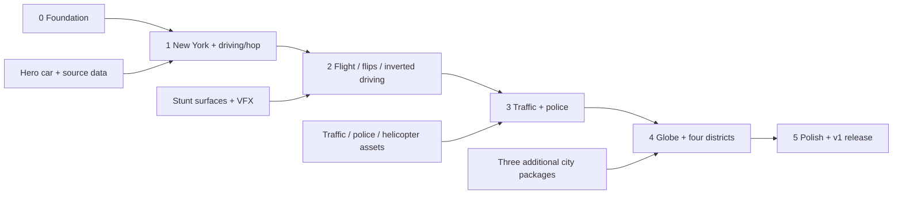

# Roadster Flight — implementation roadmap

Status: implementation checklist, October 16, 2026. Unchecked items are future work.
See [current build status](BUILD_STATUS.md) for evidence and known limitations.
Read [architecture](ARCHITECTURE.md) for system decisions and
[assets](ASSETS.md) for the separate visual/audio/data requests.

## Delivery order and release meaning

**One city + drive/hop → flight/flips/inverted driving → cops → globe/four cities → polish.**

The first playable is a smaller release than complete version one. Real geography
and a recognisable car are part of the first playable's public-facing target.
Proxies can unblock physics internally, but a box car in a random city does not
meet the visual goal. The current driving prototype implements the foundation
and part of milestone one; its final car/fidelity release gate remains open.

## Milestone 0 — reproducible foundation

Goal: a maintainable static application that loads, pauses and disposes cleanly.

- [x] Add npm project, Vite and TypeScript; lock compatible Three.js and Rapier versions.
- [x] Replace CDN import with bundled dependency; retain existing city IDs.
- [x] Add typecheck/build scripts and a lightweight CI workflow.
- [x] Add `App` and `GameSession` lifecycle; one canvas and one animation loop.
- [x] Add fixed-step clock, keyboard actions and pause/blur handling.
- [x] Initialise single-threaded Rapier with metre units and explicit vehicle axes.
- [ ] Add debug toggles for colliders, contact rays, speed and frame timings.
- [x] Add loading/error states and an honest unavailable state for unbuilt cities.
- [x] Add `.gitignore` for dependencies, outputs, local environment and raw data.
- [ ] Record reference hardware/browser versions and a repeatable benchmark route format.
- [ ] Define a code-licence decision and asset/source ledger before public release.

Exit gate:

- Fresh checkout installs and builds with the documented runtime and `npm ci`.
- Production preview works under `/roadster-flight/`, including Rapier startup.
- Holding keys, releasing focus and resuming cannot leave acceleration stuck.
- Re-entering a session does not add canvases, animation loops or listeners.
- Unsupported rendering or a failed required load produces an actionable screen.

## Milestone 1 — New York, driving, boost and hop

Goal: the first playable loop: start, drive a real district, boost, jump and land.

### 1A. Prove vehicle mechanics on a temporary course

- [x] One dynamic chassis, four suspension rays, simple collision hulls.
- [x] Accelerate, steer, brake, reverse, camera cycle and safe reset.
- [ ] Tune suspension/grip/centre of mass on straight, slalom, kerb and incline fixtures.
- [x] Add Space boost with pressure use, speed cap and cooldown/refill feedback.
- [x] Add edge-triggered Shift hop with grounded hysteresis and mass-scaled impulse.
- [x] Add chase-camera smoothing, obstruction handling and horizon stability.
- [x] Add HUD speed/pressure, controls and pause overlay.

### 1B. Prove the import pipeline on one real block

- [x] Select and record exact Midtown bounds and a pinned OSM source.
- [x] Implement data schema and longitude/latitude-to-local-metre conversion.
- [x] Import one block's road geometry, intersections, footprints and level metadata.
- [x] Generate independent colliders and a minimal directed road graph.
- [ ] Check dimensions, road widths, scale, heading and visual/collider agreement.
- [x] Capture source date/checksum, adapted-data availability and attribution records.

### 1C. Expand to one bounded district

- [ ] Build a connected 1 km-scale district with a boost straight and safe spawns.
- [ ] Produce chunk manifests, static assets, readiness checks and safe boundary handling.
- [ ] Add simple street furniture/parked cars as hop targets with semantic collision IDs.
- [ ] Integrate the reveal-referenced car model, PBR materials, lights and wheel animation.
- [ ] Add daylight environment, shadows and enough facade/landmark detail to read as New York.
- [ ] Bundle all required runtime assets and test cold-cache loading on throttled network.

Exit gate:

- Drive a connected route for ten minutes, brake/reverse, and reset without instability.
- Perform at least twenty hop/land cycles, including while moving and after rough landings.
- Repeated Shift keydown while held cannot produce repeated grounded jump impulses.
- Boosted collisions with a fixed wall and a parked car do not pass through them.
- No visible road seams swallow the car; chunk edges remain driveable under network delay.
- The public-facing car silhouette matches the chosen reveal references from front,
  rear and side; a labelled proxy is acceptable only for an internal mechanics build.
- The route is traceable to actual source streets and blocks; fallback estimates are recorded.
- New York is available; unbuilt cities are visibly unavailable.
- Measured performance and transferred spawn bytes meet targets or have a documented fix.

Deliverable: **first playable**, with a short readme of controls and actual district bounds.

## Milestone 2 — assisted flight, flips and upside-down driving

Goal: recreate the playful reveal-inspired manoeuvres with recoverable controls.

- [ ] Extend Shift hold to bounded airborne lift; keep press-to-hop semantics.
- [ ] Share pressure across boost/lift/roll; add recharge delay and depletion behaviour.
- [ ] Add airborne pitch/yaw control and capped landing assistance.
- [ ] Implement F as one torque-controlled barrel roll with timeout and collision cancellation.
- [ ] Make contact mode transitions stable across ground, air, adhesion and reset.
- [ ] Import/build a labelled stunt ramp with a short inverted driving section.
- [ ] Validate suspension on the inverted fixture; add surface-drive assist if required.
- [ ] Add wheel-side contact probes, normal filtering, adhesion caps and clean edge release.
- [ ] Add pooled pale-vapour jets, thrust onset/loop/release audio and restrained camera effects.
- [ ] Extend chunk readiness to predicted flight/landing corridors.

Exit gate:

- Take off, steer, complete one F roll and land repeatedly from the intended stunt route.
- A held F key produces one roll; ground F, depleted pressure and low clearance fail cleanly.
- Pressure never becomes negative; low-pressure flight still falls and collides normally.
- Drive under the designated inverted section, leave its edge and regain ordinary flight.
- The car cannot stick to arbitrary building walls or a surface beyond probe reach.
- Hop breaks adhesion predictably; hitting an obstacle cancels active roll assistance.
- Reset works after an upside-down failed landing and places the body above valid road geometry.
- The camera stays usable while the chassis rolls; reduced motion removes strong shake.
- High-speed flight cannot enter an unready collision area or land on an unloaded chunk.

## Milestone 3 — traffic, wanted level, road chases and helicopter

Goal: make collisions lead to a fair, readable chase on the real road graph.

### 3A. Traffic and incidents

- [ ] Generate lane guides, legal junction connectors and spawn segments.
- [ ] Implement a small dynamic traffic pool with speed following and obstacle checks.
- [ ] Add left/right driving-side support as data, even though the first city drives right.
- [ ] Add intersection stop/yield rules and stuck detection.
- [ ] Add contact incident classification, responsibility, severity and pair cooldown.
- [ ] Add a bounded set of breakable props and cosmetic crash feedback.

### 3B. Police

- [ ] Add heat thresholds, wanted display, last-seen position and search/decay timers.
- [ ] Add one patrol first; drive graph routes before introducing multiple intercept roles.
- [ ] Add A* route selection, player prediction, legal pursuit steering and replanning budget.
- [ ] Scale police to the architecture's bounded wanted-level budgets.
- [ ] Add occlusion-aware sightings and search around last known position.
- [ ] Route ground police toward roads near an airborne player's likely landing area.
- [ ] Add one helicopter at level four with guided movement, spotlight and occlusion.
- [ ] Add stationary capture countdown, escape feedback and restart flow.
- [ ] Add police/siren/helicopter assets and audio from the separate checklist.

Exit gate:

- Support contact and a minor kerb tap do not increase heat; a qualifying crash does.
- A sustained vehicle contact creates one incident per impact window, not 60 per second.
- Police use legal directed roads, respect vertical separation and do not cut through blocks.
- Ground cops remain road-bound while the player flies.
- Losing sight causes search, then decay; the helicopter cannot see through a building.
- Multiple pursuers run without constant pileups or per-frame A* spikes.
- No police spawn inside the player or visibly teleport out of an obstruction.
- Capture requires the displayed low-speed/proximity condition for its full duration.
- Reset preserves wanted state and cannot repeatedly restart escape timers in the player's favour.
- A ten-minute high-heat chase stays within the dynamic-entity and performance budgets.

## Milestone 4 — globe and four playable districts

Goal: a keyboard-friendly globe that launches genuinely different places.

- [ ] Create geographic markers for New York, Tokyo, London and Dubai.
- [ ] Add keyboard navigation, Enter confirmation, focus visibility and Escape/back.
- [ ] Reuse the city-loader lifecycle, package schema and loading/error states.
- [ ] Build/import one bounded district for each additional city, after New York gates pass.
- [ ] Select legal source data, an identifiable local landmark and clear district coverage per city.
- [ ] Configure driving side, origin, bounds, spawn, lighting preset and source records.
- [ ] Verify lane connectors/turns for Tokyo and London left-side traffic.
- [ ] Add per-city package size/readiness checks and failed-download retry.
- [ ] Abort obsolete loads and release prior city physics/render/audio resources.
- [ ] Use a licensed lightweight globe texture; suspend globe rendering during play.

Candidate districts, subject to source-data/route QA:

| Menu city | Candidate starting area | Coverage selection constraint |
| --- | --- | --- |
| New York | Midtown Manhattan | Connected grid, boost straight, skyline sightline |
| Tokyo | Shinjuku | Left-side traffic; avoid unresolved multilevel intersections initially |
| London | Westminster / South Bank area | Recognisable sightlines; include bridges only with verified elevations |
| Dubai | Downtown near Burj Khalifa | Car-accessible connected loop; verify complex junctions and building scale |

Exit gate:

- All four markers launch distinct packages at correct city-specific spawns.
- Street layouts, landmarks and traffic directions match each district's source data.
- No complete-city coverage is implied where only a district is provided.
- Full keyboard start/select/play/pause/return flow works without a mouse.
- Missing packages show retry/unavailable state; they never load another city silently.
- Ten successive city switches leave no old physics bodies, loops, listeners or growing asset counts.

## Milestone 5 — polish and free v1 release

Goal: a coherent public browser game within free static-hosting constraints.

- [ ] Tune car, flight and pursuit feel from complete play sessions.
- [ ] Optimise LODs, texture compression, draw calls, shadow distance and dynamic pools.
- [ ] Add low/medium/high presets, volume controls and reduced-motion setting.
- [ ] Balance positional sirens, wind, tyre and thruster audio; support mute and tab pause.
- [ ] Improve road/paint/glass/reflections and landmark sightlines from review screenshots.
- [ ] Add concise control onboarding and clear loading/escape/busted feedback.
- [ ] Check readable HUD at 1280×720, 1920×1080 and ultrawide aspect ratios.
- [ ] Finalise code licence, third-party notices, map attribution and adapted-data distribution.
- [ ] Add documented support expectations and troubleshooting for browser/GPU errors.
- [ ] Add Pages workflow and deploy the release after main-branch checks pass.
- [ ] Verify the actual GitHub Pages nested URL with cache cleared and slow network.
- [ ] Tag the tested release and document known district/data limitations.

Exit gate: every acceptance scenario below passes, all four city packages and
required assets are available, and the release fits measured performance and
hosting budgets. Do not label the New York-only build complete v1.

## Verification plan

Keep automated coverage focused on rules that can regress; use playtesting and
screenshots for feel, fidelity and camera composition.

| Area | Method | Required evidence |
| --- | --- | --- |
| Fixed timestep/input | Simulate identical actions at 30/60/144 Hz render schedules | Comparable trajectories within tolerance; one action per key press |
| Suspension and thrust | Physics fixtures with flat ground, incline, wall and moving car | Stable rest, controlled stopping, hop height range, no tunnelling in capped envelope |
| Pressure and flip | Tick-level rule checks plus flight course | Costs/refill boundaries, action locks, cancellation and safe depletion |
| Adhesion | Inverted fixture and edge transitions | Actual tyre-side contact/drive, bounded assist, clean detach |
| Incidents/wanted | Synthetic impacts and visibility timelines | Dedupe, thresholds, unseen delay, reacquisition and reset semantics |
| Road graph | Small fixture graphs and imported-package validator | One-way/turn/level legality, connected spawn routes, no invalid coordinates |
| Streaming | Delayed/failed fetches and rapid city changes | Collision readiness, safe boundary, cancelled stale responses, bounded resources |
| Static hosting | Production preview under project prefix; Pages smoke test | All scripts/models/WASM/decoders fetch successfully; no runtime map API required |
| Fidelity | Fixed front/rear/side car and street screenshots | Comparison against approved reveal and geography references |
| Performance | Recorded route plus dense high-heat flight, warm/cold cache | Frame percentiles, physics time, transferred bytes, resource counts and hardware |

Browser matrix: current desktop Chrome/Edge and Firefox, plus Safari on macOS
where WebGL2/WASM are supported. Record tested versions at release. Test ordinary
keyboard layouts, either Shift key, blur, tab suspension and audio unlock. A
WebGL2 capability failure must be explicit rather than an empty screen.

## First implementation batch

Take these in order; each should leave a reviewable working state:

1. Build setup and lifecycle: milestone 0, preserving a visible starter scene.
2. Physics/input course: ground drive, camera, boost, hop and reset.
3. Map importer proof: one real block, colliders and graph with provenance.
4. New York playable: connected district, readiness and boundaries.
5. Hero-car visual pass and first-playable gate.

Source the car references and New York source data early because they can delay
the visual gate. The separate asset checklist records the exact handoff required.
Keep flight, police and globe expansion behind the preceding milestone gates.
